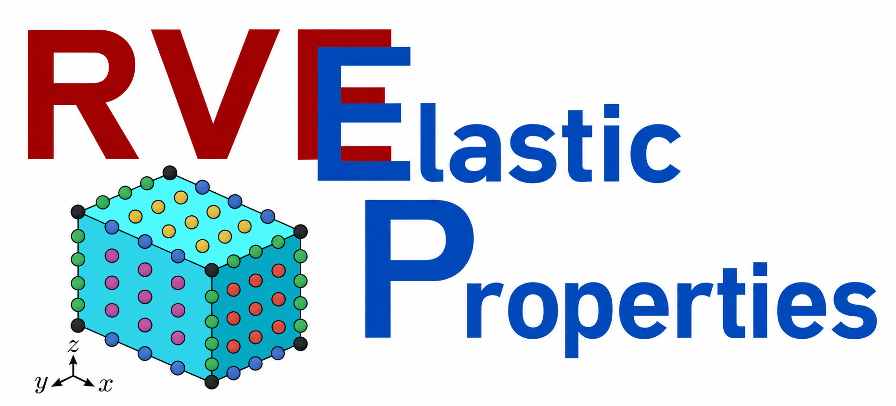

# RVE2P

  

Abaqus scripts for computing effective elastic properties of RVEs using periodic boundary conditions.

# Instruction
1. Create Model-1 with a RVE as a part;
2. Set materials, sections;
3. Create symmetric mesh;
4. Run RVE2P.py
5. Wait untril done
